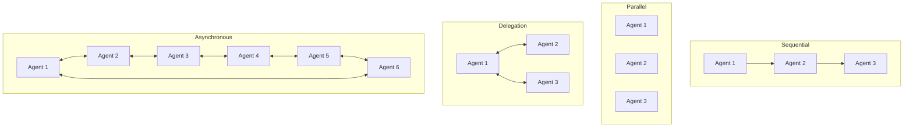

# Agentic AI and CrewAI

## What is CrewAI?
- CrewAI is a framework for creating and managing AI agents.
- It helps you build, deploy, and monitor AI agents with an easy-to-use interface.
- CrewAI breaks ideas into small, manageable parts.
- It gives patterns and tools for building agents and letting them work together.
- You can create custom tools for your agents.
- CrewAI also lets you deploy and manage agents in real-world applications.

## Main Building Blocks
- **Agents**: The main parts of CrewAI. Agents do tasks and make decisions.
```python
from crewai import Agent
planner = Agent(
        role="Content Planner",
        goal='Plan engaging and factually accurate content on {topic}',
        backstory="You're working on planning a blog article ...",
        allow_delegation=False,
        verbose=True
    )
```
- **Tasks**: The jobs agents do. Tasks can be simple or complex.
  - A clear description of the task
  - Set a clear and concise goal/expectation
  - Set a context
  - Set a callback
  - Override Agent tools with specific task tools
  - Force human review
  - Execute asynchronously
  - Choose an output format: JSON, CSV, or plain text
  
```python
from crewai import Task
task = Task(
        name="Plan a blog article",
        description="Create a detailed outline for a blog article on {topic}",
        inputs=["topic"],
        outputs=["outline"],
        tools=["Google Search", "Keyword Research Tool"]
    )
```
- **Tools**: The resources agents use to do their tasks. Tools can be anything from APIs to databases.
- **Crews**: A team of agents working together toward a common goal. Each agent can have different skills.
  - A team of Crew is a combination of multi agents and a task(s) with tools.

> Note: In CrewAI, tasks happen one after another (sequentially). For example, tasks = [plan, write, edit].

## Key Elements of CrewAI
- **Role Playing**: Agents have special roles (like planner, writer, editor, analyst) for focused tasks.
- **Goal-Oriented**: Every agent has a clear goal, such as writing an article or making a marketing plan. Too much information can confuse the agent.
- **Tools**: Choose tools that fit the agent’s role and goals. Tools should be easy, reliable, and accurate. Different ways to give agents tools:
    - **Agent Level**: The Agent can use the Tool(s) on any Task it performs. 
    - **Task Level**: The Agent will only use the Tool(s) when performing that specific Task.
- **Cooperation**: Agents work together to finish complex tasks. They share information, delegate jobs, and use resources efficiently.
    - Process: There are two ways to delegate tasks:
        - **Sequential**: One agent finishes a task before the next one starts.
        - **Parallel**: Multiple agents work on different tasks at the same time.
        - **Delegation**: Agents can ask other agents for help. This is called delegation. It helps agents work together and share information.
        - **Asynchronous**: Agents can work on tasks at different times. This is called asynchronous processing. It helps agents work together without waiting for each other.

- **Guardrails**: Set limits for agents to prevent mistakes or make-believe answers. Guardrails keep agents in their roles.
- **Memory**:
  - **Short-term memory**: Remembers info for the current task. Shared with other agents and deleted after the task.
  - **Long-term memory**: Remembers the previous experiences to help in the future. Kept for a long time and helps agents improve.
  - **Entity memory**: Remembers information about specific people, places, or organizations for future use. Kept for a long time.