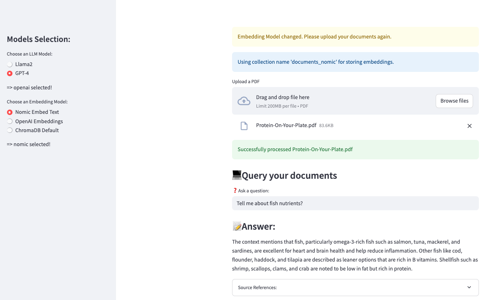
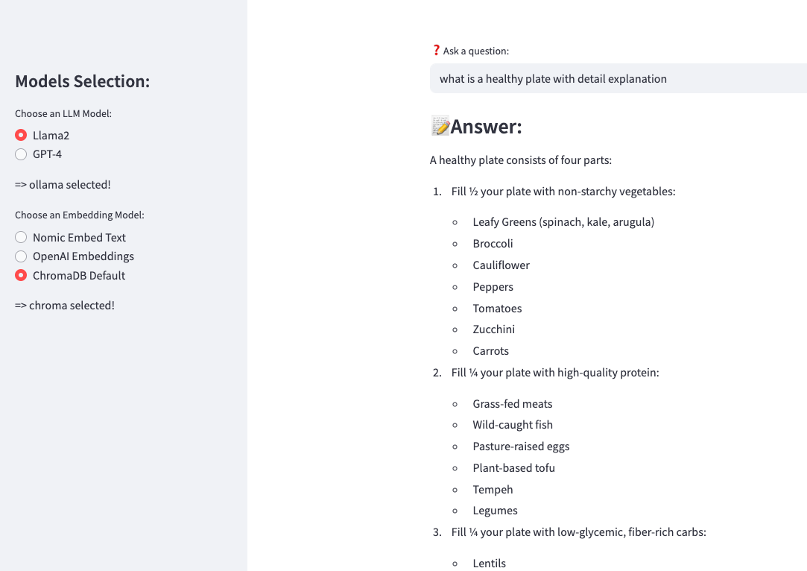

# RAG for PDFs

A Streamlit app for uploading a PDF and asking questions about it, built with a pluggable,
modular pipeline rather than one script — the more architected sibling of
[`../rag-complex/`](../rag-complex/readme.md) (which is a generic "bring your own data" knowledge
base explorer; this one is PDF-specific and lets you swap embedding/LLM backends per session).




## How it's structured

| File | Responsibility |
|---|---|
| `app.py` | Streamlit UI: sidebar model selection, PDF upload, query box. |
| `model_selector.py` | `ModelSelector` — the list of available LLM (Ollama/OpenAI) and embedding (Nomic/OpenAI) options shown in the sidebar. |
| `pdf_processor.py` | `PDFProcessor` — extracts text with PyPDF2 and splits it into overlapping chunks (1000 chars, 200 overlap). |
| `rag_system.py` | `RAGSystem` — owns the ChromaDB collection, embeds/stores chunks, and generates answers from retrieved context via Ollama or OpenAI. |

Data flow: PDF upload → `PDFProcessor` chunks it → `RAGSystem` embeds + stores chunks in a local
ChromaDB collection (`./chroma_db`, gitignored) → a question embeds the same way → top chunks are
retrieved → the LLM answers using those chunks as context, with sources shown in an expander.

## Prerequisites

- Python 3.11
- For the Ollama option: [Ollama](https://ollama.com) running locally with `llama3.2:latest` pulled.
- For the OpenAI option: an `OPENAI_API_KEY` in a local `.env` file (gitignored).

## Install & run

```bash
pip install -r requirements.txt
streamlit run app.py
```

## Notes

- Switching the embedding model mid-session clears previously processed files — embeddings from one
  model aren't compatible with another's vector space, so the app makes you re-upload.
- `demo/demo.mov` (if present locally) and `chroma_db/`, `pdf/` are gitignored — they're
  generated/recording artifacts, not source.
