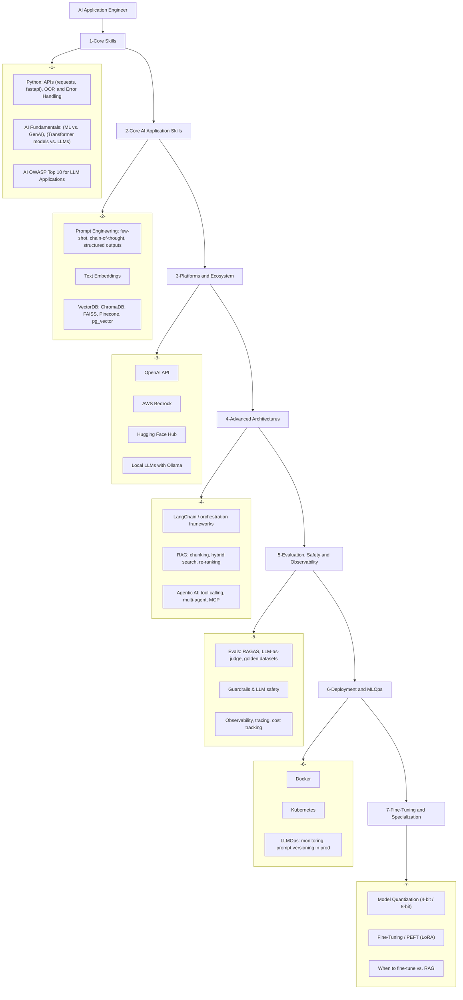

## Generative AI Application Engineer Roadmap

_Last updated: 2026-11-03. Stages 5 and 7 were added after reviewing current (2026) AI engineer hiring
data and roadmaps — evaluation/observability and fine-tuning are now explicitly called out as their own
stages rather than being folded into "Advanced Architectures." See Sources at the bottom._

### Stage-by-stage notes

1. **Core Skills** — the prerequisites: Python fundamentals good enough to build and call APIs,
   enough ML background to know what a transformer/LLM actually is, and awareness of the OWASP
   Top 10 for LLM Applications (prompt injection, data leakage, etc.) before you ship anything.
2. **Core AI Application Skills** — the building blocks every GenAI app uses: writing effective
   prompts, generating and storing embeddings, and querying a vector database.
3. **Platforms and Ecosystem** — where the models actually come from: hosted APIs (OpenAI, Bedrock),
   open model hubs (Hugging Face), and running models locally (Ollama).
4. **Advanced Architectures** — composing the above into real systems: orchestration frameworks,
   full RAG pipelines, and agentic systems that call tools and talk to each other (MCP).
5. **Evaluation, Safety and Observability** — in 2026 hiring data this is as important as RAG or
   agents, but it's easy to skip: can you measure whether your RAG/agent is actually correct,
   guard against unsafe outputs, and trace/cost-monitor it in production?
6. **Deployment and MLOps** — packaging and operating the app: containers, orchestration, and the
   LLM-specific ops practices (prompt versioning, monitoring) on top of generic MLOps.
7. **Fine-Tuning and Specialization** — intentionally last: most production GenAI work never needs
   this. It's worth learning once steps 1-6 are solid, for cases where RAG/prompting hit a ceiling
   and you need a cheaper or more specialized model.

### Status (repo coverage)

The repo folders are numbered and named to match the stages above.

| Stage | Status | Repo folder(s) |
|---|---|---|
| 1. Core Skills | ⬜ Not started | `1-core-skills/` (placeholder) |
| 2. Core AI Application Skills | 🟨 Partial | `2-core-ai-app-skills/prompt-engineering/`, `2-core-ai-app-skills/vectordb/` — Pinecone and pg_vector not yet covered. `2-core-ai-app-skills/summary-text/` is a small applied project drawing on these skills. |
| 3. Platforms and Ecosystem | 🟨 Partial | `3-platforms-ecosystem/ollama-chatbot/` (Ollama), `3-platforms-ecosystem/aws-bedrock-rag/` (Bedrock) — OpenAI used throughout Stage 2/4 folders, Hugging Face Hub not yet covered directly |
| 4. Advanced Architectures | ✅ Covered (overlapping) | `4-advanced-architectures/langchain/`, `4-advanced-architectures/rag-complex/`, `4-advanced-architectures/rag-pdf/` (RAG); `4-advanced-architectures/ai-agent/` (Agentic AI, CrewAI) |
| 5. Evaluation, Safety and Observability | ⬜ Not started | `5-evaluation-safety-observability/` (placeholder) |
| 6. Deployment and MLOps | ⬜ Not started | `6-deployment-mlops/` (placeholder) |
| 7. Fine-Tuning and Specialization | ✅ Covered | `7-fine-tuning/` (quantization on Apple Silicon) |

### Sources

- [AI Engineer Roadmap 2026: What 390 Job Postings Actually Require](https://dev.to/ali_82f3409ed625e8ba8515b/ai-engineer-roadmap-2026-what-390-job-postings-actually-require-3jdo)
- [The Agentic AI Engineer Roadmap for 2026: Skills, Stack and Order](https://medium.com/data-science-collective/the-agentic-ai-engineer-roadmap-for-2026-skills-stack-and-order-fc1dfa17948d)
- [AI Engineer Roadmap 2026: RAG, Agents & Evals](https://dataskew.io/roadmaps/ai-engineering/)
- [The GenAI Engineer Roadmap for 2026: Principles to Shipping Agents](https://www.interviewbit.com/varsity/blog/the-genai-engineer-roadmap/)
